<!-- ============================================================ -->
<!--     NGABDULLAH HAKIM · GITHUB PROFILE                         -->
<!--     Bento Studio style: Obsidian Slate + Warm Amber           -->
<!--     Facts aligned with ngabdullahhakim.com                    -->
<!-- ============================================================ -->

 

 

 

## Who is Ngabdullah Hakim?

**Ngabdullah Hakim** is a Fullstack Software Engineer based in Surabaya, Indonesia. As **Lead Software Engineer** at **PT Meta Media Optima**, he engineers three production platforms: **Aire** (AC booking and technician dispatch), **Venus Gadget** (a 130+ SKU electronics e-commerce store), and **Traversa** (an escrow-backed travel marketplace), working across Go, Laravel, Next.js, Flutter, and PostgreSQL, alongside Linux VPS and Docker infrastructure and end-to-end Technical SEO. He is also the founder of **TKA & UTBK Tracker**, an adaptive exam preparation platform trusted by 1k+ students on Google Play (1k+ downloads, 5.0 rating).

<table>
<tr>
<td width="50%" valign="top">

#### ● Right Now

- Lead engineering at PT Meta Media Optima
- Building Go / Gin and CodeIgniter 4 backends, multi-database PostgreSQL operations
- Founder of TKA & UTBK Tracker, growing it on Google Play
- Learning Python automation and AI agents, exploring Web3 smart contracts
- Building in public on LinkedIn

</td>
<td width="50%" valign="top">

#### ● Focus in 2026

- Clean, scalable Go backends
- Technical SEO and search analytics that move real products
- Shipping products to production, not just local demos
- A living portfolio at **ngabdullahhakim.com**

</td>
</tr>
</table>

`Certified Junior Programming Assistant (BNSP)` · `DBS Foundation Coding Camp · AWS Cloud & GenAI` · `National Youth Ambassador, Duta Pesona Indonesia Batch 7`

 

## Tech Arsenal

`s e r v e r`

`c l i e n t`

`d a t a · i n f r a · t o o l s`

`s e o · a n a l y t i c s`

`Technical SEO` `Google Search Console` `GA4` `Google Tag Manager` `Ahrefs` `Semrush` `Screaming Frog` `Schema.org / JSON-LD` `Core Web Vitals`

 

## Featured Work

| Project | What it is | Stack |
|---|---|---|
| **TKA & UTBK Tracker** | Adaptive exam preparation on web and Google Play, trusted by 1k+ students: timed mock tests, live quizzes, AI question extraction | Laravel 12 · Flutter · PostgreSQL · Alpine.js |
| **Aire** | AC service booking, technician dispatch, and automated multi-database operations at PT Meta Media Optima | Go / Gin · CodeIgniter 4 · PostgreSQL · Flutter |
| **Venus Gadget** | 130+ SKU electronics storefront with Midtrans sub-merchant checkout and full Technical SEO | Next.js 15 · Go · Midtrans · Tailwind CSS |
| **Traversa** | Escrow-backed travel marketplace with operator verification and dispute resolution | Flutter · Go · PostgreSQL · Microservices |
| **Panel Kim** | Internal production VPS watchdog and multi-agent workflow dashboard in a single binary | Go / Gin · React · Vite · Docker |
| **ShadowScan OSINT Console** | Open-source intelligence investigation system with 6 modules and 46+ passive platform probes | Next.js · REST API · OSINT |
| **Server Journey** | Interactive 8-part, 38-step Linux server learning platform with an embedded AI study assistant | Linux · SSH · UFW · Cloudflare Tunnel |
| **Kasirku POS** | Dual-screen retail POS syncing cashier and customer displays in real time, with WebSocket alerts and an AI assistant | Laravel 12 · PostgreSQL · WebSockets |
| **KasTumbuh** | SAK EMKM compliant bookkeeping and cash-flow analytics for SMEs | React · Node.js · Express · PostgreSQL |

> Project proof lives as photos and demos at [ngabdullahhakim.com](https://ngabdullahhakim.com), not as public repositories.

 

## GitHub in Motion

 

## Let's Connect

Have a project, an opportunity, or just want to talk Go, Laravel, or Flutter? My door is always open.

  

